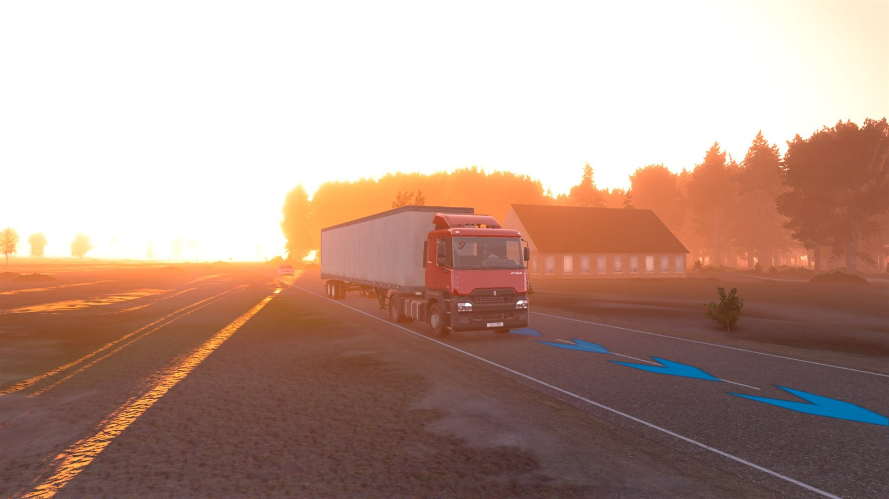
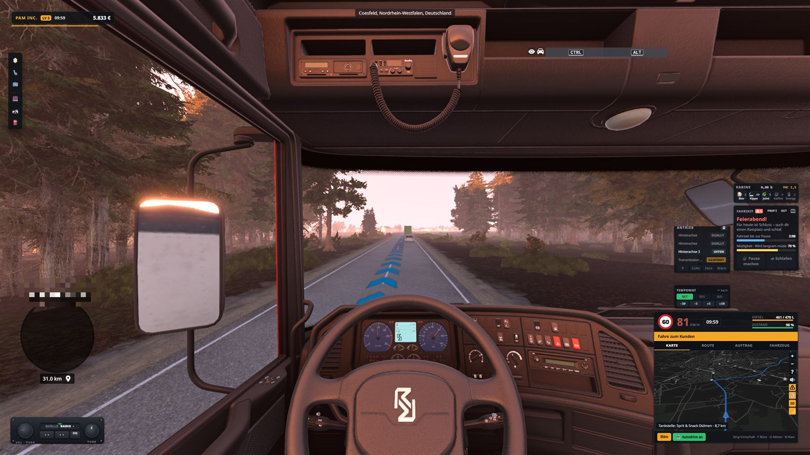
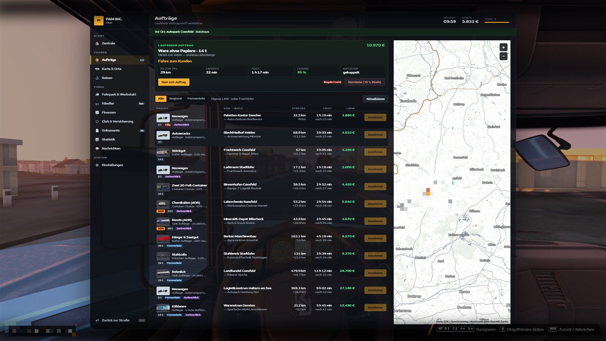
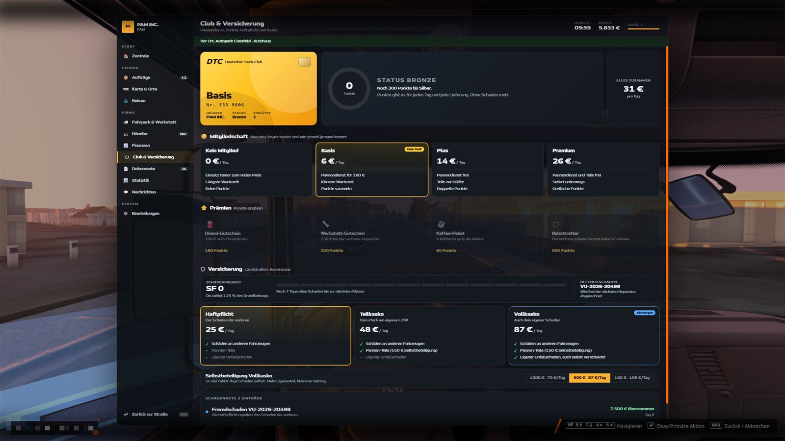
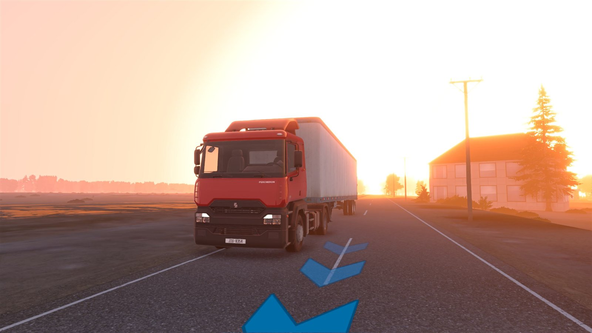
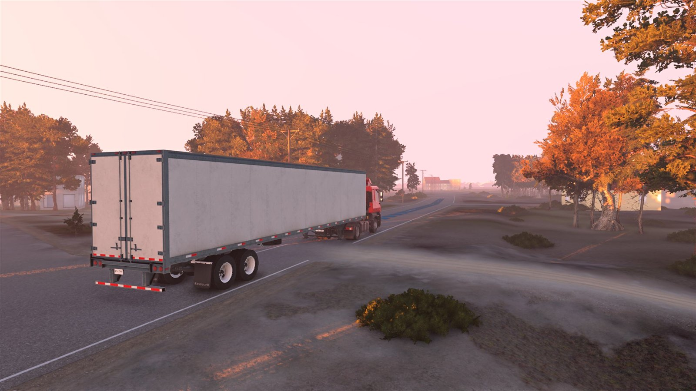
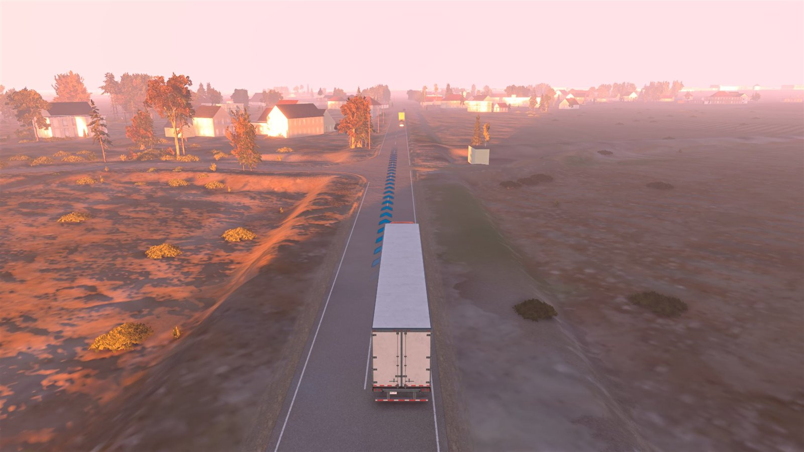

# Trucks of Earth

**Gründe deine eigene Spedition und fahre Aufträge auf echten Straßen.** Eine große Lkw-Karriere für [BeamNG.drive](https://www.beamng.com/) auf der realen Welt von BeamNG.Earth: von der ersten Tour im Leih-Lkw bis zum eigenen Fuhrpark.

Die Mod ist komplett auf Deutsch.

| | |
|---|---|
| **Spielversion** | BeamNG.drive 0.40 |
| **Pflicht-Mod** | [BeamNG.Earth](https://github.com/TecnaGamer/BeamNG.Earth) ab Version 1.8, nicht im Download enthalten |
| **System** | Windows, Internetverbindung |
| **Download** | [Neueste Version](../../releases/latest) |

## Bilder

| | |
|---|---|
|  |  |
|  |  |
|  |  |

## Was dich erwartet

**Dein Alltag als Fahrer**
- Aufträge zwischen echten Firmen und Orten, mit Lieferfrist und Sternewertung am Ende
- Auflieger ankuppeln, Ladung sichern, ADR-Gefahrgut, Milchtouren, Fernverkehr mit Fähre, Autozug und Flug
- Fahrtenschreiber mit echten Lenk- und Ruhezeiten, dazu Müdigkeit, die dir irgendwann die Augen zufallen lässt
- Kabine mit Kaffee, Energydrink, Bier, Zigaretten und mehr, und mit Folgen bei der nächsten Polizeikontrolle
- Deutsche Navi-Ansagen, Tempomat, kaufbare Assistenzsysteme, virtuelle Spiegel

**Eine Straße, die lebt**
- Baustellen, Blitzer, Laser, Polizeikontrollen mit Gespräch, Pannenautos, Unfälle, Blaulicht, Ölspuren, Schwertransporte, Falschfahrer
- Verkehr, der überholt und Rücksicht nimmt
- Echtes Wetter, Tag und Nacht, CB-Funk

**Wenn etwas schiefgeht**
- Bei Unfällen fahren Polizei und Rettungsdienst von hinten heran, mit Unfallbericht, Fotos und Dashcam
- Reifenplatzer, Kühlerschaden, Notlauf und Ölverlust, auch ohne deine Schuld
- Ein Pannendienst kommt wirklich angefahren und repariert vor Ort
- Club-Mitgliedschaft mit Punkten, dazu Haftpflicht, Teilkasko oder Vollkasko mit Schadenfreiheitsrabatt

**Deine Firma**
- Lkw kaufen, auch gebraucht und mit versteckten Mängeln
- Finanzen und Kredite, Dokumente, Statistik mit entdeckten Orten und Fahrerwertung

**Im Führerhaus**
- Internetradio mit Regionalsender je Bundesland, Spotify-Steuerung, Equalizer und Videoplayer

Ein Handbuch im Spiel erklärt beim ersten Start alles Schritt für Schritt.

## Schnellstart

1. [BeamNG.Earth](https://github.com/TecnaGamer/BeamNG.Earth) von seiner eigenen Seite installieren.
2. Unter [Releases](../../releases/latest) die Datei `trucks_of_earth.zip` laden.
3. Die Zip **ungeöffnet** nach `%LOCALAPPDATA%\BeamNG\BeamNG.drive\current\mods` legen.
4. BeamNG.drive starten und die Mod aktivieren.
5. Im Hauptmenü **Mehr → Trucks of Earth → Neue Karriere** wählen.

Die genaue Anleitung und die empfohlenen Zusatz-Mods mit Links stehen in [docs/INSTALLATION.md](docs/INSTALLATION.md). Nötig ist nur BeamNG.Earth. Mods, die du nicht willst, kannst du gern weglassen oder deaktivieren und schauen, wie es dann läuft.

## Anleitungen

- [Installation, Update, Deinstallation](docs/INSTALLATION.md)
- [Spielanleitung](docs/SPIELANLEITUNG.md)
- [Häufige Fragen und Fehlerhilfe](docs/FAQ.md)
- [Änderungen](CHANGELOG.md)

## Bekannte Einschränkungen

- **Hof-Upgrades werden in dieser Version noch nicht unterstützt**, auch wenn sie im Spiel angezeigt werden. Das Einstellen von Fahrern setzt ein Hof-Upgrade voraus und ist deshalb ebenfalls betroffen.
- Der Equalizer wirkt bei Spotify nur über die Quelle LINE.
- Firmen und Rastplätze sind für Deutschland und die Nachbarländer mitgeliefert. Anderswo gibt es weniger Ziele.
- Die Mod nutzt interne Funktionen von BeamNG.Earth. Nach größeren Updates von BeamNG oder BeamNG.Earth kann etwas nicht mehr passen.

## Fehler melden

Bitte als [Issue](../../issues/new/choose) mit der Datei `beamng.log`. Wo sie liegt und was sonst hilft, steht in den [häufigen Fragen](docs/FAQ.md).

## Rechtliches

Dies ist ein Fan-Projekt ohne Verbindung zu BeamNG GmbH oder zu BeamNG.Earth. Orte und Straßen sind echt, alle Firmen im Spiel tragen erfundene Namen. Ähnlichkeiten mit echten Unternehmen sind Zufall. Alle Marken gehören ihren Inhabern. Die Lizenz steht in [LICENSE](LICENSE), fremde Daten und Programme in [THIRD_PARTY.md](THIRD_PARTY.md).
