# Die Verkehrs-KI von Trucks of Earth

Ab Version 1.0.5 fährt der Verkehr um deinen LKW nicht mehr einfach nach Schema F. Eine eigene Verkehrs-KI denkt mit: Sie bremst rechtzeitig statt hart, fährt um Baustellen und Unfälle herum, macht auf schmalen Straßen Platz und bringt viel mehr Autos auf die Straße, ohne dass die Bildrate leidet.

## Wer mit wem spricht

Im Zentrum steht die **Leitstelle**. Alle halbe Sekunde schaut sie auf jedes Auto und entscheidet: Tempo, Spur, Abstand, Überholen, Ausweichen, Notbremse. In jedem Auto sitzt ein **eigener Fahrer**, der lenkt, Gas gibt, rollen lässt und bremst, und zwar weich, mit einem eigenen Charakter: Manche halten viel Abstand, andere fahren flotter. Nur wo es wirklich nötig ist, übernimmt die eingebaute KI von BeamNG.

## Viel Verkehr, wenig Rechenarbeit

Nur die Autos nah an dir sind echte Fahrzeuge mit Physik. Weiter weg fahren **Platzhalter**: das echte Modell, aber ohne Physik. Außer Sicht ist jedes Auto nur noch ein **Punkt auf dem Straßennetz**, der trotzdem mit Abstand fährt, die Spur wechselt und im Stau steht. Kommt einer näher, wird er an genau derselben Stelle mit demselben Tempo zum echten Auto. Entfernt er sich, schläft das echte Auto wieder ein.

## Mitdenken statt Vollbremsung

Baustellen, verlorene Ladung und Unfallstellen sperren einen Teil der Fahrbahn. Der Verkehr erkennt das, wechselt rechtzeitig die Spur oder wartet auf eine Lücke im Gegenverkehr und fährt mit Blinker vorbei. Auf schmalen Straßen fahren zwei Entgegenkommende früh langsamer, weichen an den Rand aus und kommen aneinander vorbei, statt voreinander stehen zu bleiben. Auch dein LKW im Autodrive fährt um Sperren herum.

## Stau mit Grund

Ein Stau entsteht nicht aus dem Nichts: An der Spitze stehen zwei Unfallautos mit Warnblinker, die linke Spur ist gesperrt. Dahinter bildet sich die Rettungsgasse, das Stop-and-go läuft als Welle nach hinten, und am Stauende blinken die Warnblinker. Dein LKW sieht das Stauende bis zu 220 m voraus und bremst weich.

## Schmale Straßen

## Jeder Test macht den Verkehr klüger

Mit **Strg+Umschalt+V** startet ein vollautomatischer Verkehrstest. Der LKW fährt 36 Minuten durch Landstraße, Autobahn, Stau und Nacht, und das **Verkehrslabor** misst dabei alles: Unfälle mit Black Box, Beinahe-Unfälle, Abstände, Notbremsungen, Bildrate. Die Messung läuft danach im **digitalen Zwilling** nach, mit dem echten Straßennetz und der echten KI, Dutzende Fahrten in wenigen Minuten. Erst wenn eine Verbesserung dort hält, kommt sie ins Spiel.

## Das Video

Alle Animationen am Stück (1:41 Minuten, 1080p) gibt es als Video zum Herunterladen [direkt hier](https://github.com/Skizzzy03/trucks-of-earth/releases/download/v1.0.5/trucks_of_earth_verkehrs_ki_1080p.mp4) und bei den [Releases](https://github.com/Skizzzy03/trucks-of-earth/releases/tag/v1.0.5).
